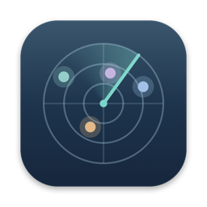
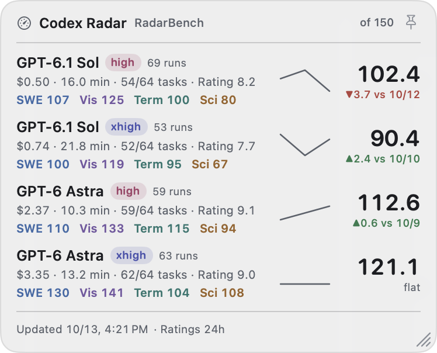
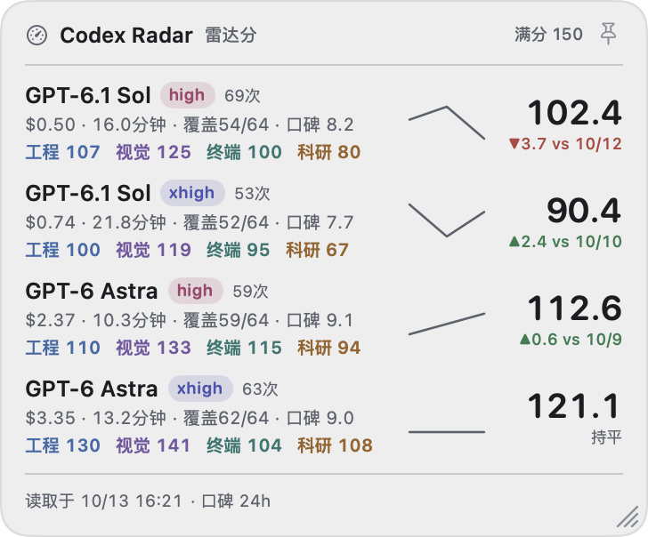

<p align="center"></p>

<h1 align="center">Codex Radar</h1>

<p align="center">
A tiny macOS desktop widget that shows live <b>RadarBench</b> scores for the Codex models you care about,
pulled from <a href="https://codexradar.com/?station=codex#intelligence-efficiency">codexradar.com</a>.
<br><a href="#中文说明">中文说明</a>
</p>

<p align="center">

&nbsp;

</p>

> Unofficial. Not affiliated with codexradar.com or OpenAI. All data belongs to codexradar.com;
> the widget reads the same public endpoints the website itself uses.

## Features

- **Live scores**: RadarBench total (out of 150) per model × effort, the same numbers the website shows, plus a change indicator against the previous grading day and a daily trend line.
- **Category scores**: SWE / Visual-spatial / Terminal / Science. Each category has its own fixed color, and you can show or hide each one.
- **Details**: average API-equivalent cost and duration per task, task coverage (x/64), graded runs, a "Low data" flag (<40 tasks), and the community rating (24h or 7d).
- **Watchlist**: pick any model/effort the site tracks (GPT-6.1 Sol, GPT-6 Astra, GPT-6 Sol, GPT-5.6 Sol, Luna…) from a menu.
- **Desktop-native**: sits above desktop icons and below your windows. Drag to move. Pin it to lock position and size.
- **Sizing**: by default the window fits its content. Drag the corner to resize manually, and ⌥-drag the corner (or use the menu) to change the text size.
- **Looks**: light, dark, or follow the system. Five background presets from solid to clear glass. Text always stays fully opaque.
- **English / 中文** UI (English by default).
- **Housekeeping**: refreshes every 30 minutes and on wake, caches the last data for offline starts, can launch at login, and lives in the menu bar (no Dock icon).

## Install

1. Download `CodexRadar-x.y.z-macOS.zip` from [Releases](../../releases/latest) and unzip it.
2. Move **CodexRadar.app** to `/Applications` (or `~/Applications`).
3. The app is ad-hoc signed, not notarized, so the first launch is blocked by Gatekeeper. Either right-click the app → **Open**, or run:
   ```bash
   xattr -dr com.apple.quarantine /Applications/CodexRadar.app
   ```

Requires macOS 14 or later. Universal binary (Apple silicon + Intel).

## Usage

Right-click the widget, or click the gauge icon in the menu bar:

| Menu | What it does |
|---|---|
| Watchlist | Choose model / effort rows |
| Show | Toggle category scores, cost · duration, coverage, runs, rating, trend line, change |
| Appearance | System / Light / Dark · background: Solid → Clear glass |
| Text size | Small → Largest (or ⌥-drag the resize corner) |
| Fit size to content | Auto width/height; double-click the corner to re-enable |
| Pin position & size (⌘P) | Locks dragging and resizing; also the 📌 button in the header |
| Language / 语言 | English / 中文 |
| Launch at login | Registers the app as a login item |

Settings live in `~/Library/Application Support/CodexRadar/config.json`. Use **Edit config file…** to change the order of rows or the refresh interval (`refreshMinutes`).

## Build from source

Needs only the Xcode Command Line Tools (no Xcode project):

```bash
./build.sh            # → build/CodexRadar.app (universal)
./build.sh --install  # build, copy to ~/Applications and launch
./build.sh --zip      # build and create the release zip
```

`icon/make_icon.swift` regenerates the app icon.

## Data sources

| Endpoint | Used for |
|---|---|
| `/data/radar-bench-binding.json` | which model/effort pairs the site tracks |
| `/api/radar-bench-score?model=…&effort=…&view=summary` | score, category scores, cost/duration, daily history |
| `/api/model-ratings?view=public&window=24h\|7d` | community ratings |

Each watched row is one request per refresh, at most every 5 minutes (30 by default). Please be gentle with the site.

---

## 中文说明

一个 macOS 桌面小组件，实时显示 [codexradar.com](https://codexradar.com/?station=codex#intelligence-efficiency) 上你关注的 Codex 模型 / effort 的 **雷达分（雷达Bench）**。

> 非官方项目，与 codexradar.com 和 OpenAI 无关。数据版权归 codexradar.com 所有，组件读取的是网站自身使用的公开接口。

**功能**

- **实时雷达分：** 与网站数值一致，满分 150。附带"较上一判分日"的涨跌和每日走势线。
- **四个分项：** 工程、视觉、终端、科研。每个分项固定一种颜色，可以分别选择是否显示。
- **其他信息：** 每题平均费用和耗时、覆盖题数（x/64）、判分次数、"数据不足"标记（少于 40 题）、社区口碑评分（24h 或 7d）。
- **关注模型：** 在菜单里勾选网站收录的任意模型和 effort。
- **桌面层显示：** 位于桌面图标之上、普通窗口之下。可以拖动，用 📌 固定后不能拖动也不能拉伸。
- **大小：** 默认自适应内容。可以拖右下角手动调整，按住 ⌥ 拖动可以缩放字号。
- **外观：** 浅色、深色、跟随系统。背景有 实色、毛玻璃、浅毛玻璃、半透明、高透明 五档，文字始终保持不透明。
- **界面语言：** 中英文切换，默认英文。
- **其他：** 每 30 分钟以及唤醒后自动刷新，离线时显示缓存数据，支持登录时启动。只显示菜单栏图标，不占 Dock。

**安装**

1. 在 [Releases](../../releases/latest) 下载 zip 并解压。
2. 把 `CodexRadar.app` 拖到「应用程序」文件夹。
3. app 没有经过公证，首次打开需要右键 →「打开」，或者执行：
   ```bash
   xattr -dr com.apple.quarantine /Applications/CodexRadar.app
   ```

需要 macOS 14 及以上，同时支持 Apple 芯片和 Intel。

## License

[MIT](LICENSE)
